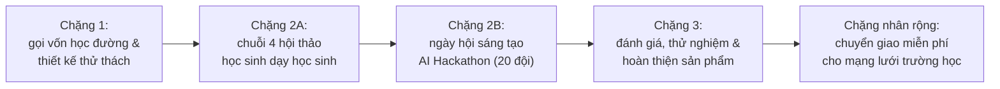

# MÔ HÌNH PHÁT TRIỂN NĂNG LỰC BẢO AN TRÍ TUỆ NHÂN TẠO
### (AI Safety Competency Framework)
**Khung Năng Lực Hội Thảo & Ngày Hội Sáng Tạo Ứng Dụng Học Tập AI An Toàn Dành Cho Học Sinh Phổ Thông**  
*Mô hình phát triển năng lực số và bảo an AI phổ quát, sẵn sàng nhân rộng cho các trường phổ thông và tổ chức giáo dục*  
*Ươm mầm thực nghiệm từ Câu lạc bộ học sinh tiên phong: VIN BEYOND AI • Khẩu hiệu: "AI an toàn, tư duy vững vàng"*

[](LICENSE)
[](https://unesco.org)
[](https://moet.gov.vn)
[](#)
[](#)
[](#)

---

🌐 **Ngôn ngữ / Languages:** **Tiếng Việt (Bản chuẩn)** | [English (Global Edition)](README_EN.md)

> 🔒 **Thông báo bản quyền & Nhãn hiệu:** © 2026 Phạm Bá Hồng Sơn. Bản quyền tác phẩm "Mô hình phát triển năng lực bảo an trí tuệ nhân tạo (AI Safety Competency Framework)" và Nhãn hiệu "BẢO AN AI"™ được bảo hộ theo Luật Sở hữu trí tuệ Việt Nam.

---

## 📌 1. TỔNG QUAN KIẾN TRÚC MÔ HÌNH: nền tảng gốc & kế thừa thực nghiệm

Trước sự bùng nổ của trí tuệ nhân tạo (AI), người học rất dễ rơi vào thói quen **ỷ lại, nhờ AI làm bài hộ**, dẫn đến lười suy nghĩ và suy giảm tư duy độc lập (hiện tượng khoán tư duy). Các văn bản chỉ đạo của Bộ Giáo dục & Đào tạo (Thông tư 18/2026/TT-BGDĐT, Công văn 2422/BGDĐT-CNTT) và khung năng lực AI của UNESCO đều nhấn mạnh: **nhà trường phải xây dựng văn hóa liêm chính và hướng dẫn người học làm chủ công nghệ một cách an toàn**.

Hệ sinh thái của đề tài được cấu trúc thành hai tầng liên kết chặt chẽ:

### 🏛️ 1.1. Mô hình năng lực gốc
* **Tên chính thức:** **MÔ HÌNH PHÁT TRIỂN NĂNG LỰC BẢO AN TRÍ TUỆ NHÂN TẠO**
* **Vai trò & ý nghĩa:** là **khung năng lực lý thuyết và kỹ thuật nền tảng gốc** do tác giả Phạm Bá Hồng Sơn sáng lập và công bố từ bài báo khoa học quốc tế chuẩn Scopus Q1 (tại Hội nghị Quốc tế IEEE iSTEM-Ed 2026). Mô hình gốc xác lập hệ thống chuẩn mực toàn diện: bảo an nhận thức, chuẩn mực đạo đức UNESCO 2024, môi trường thử nghiệm bảo mật tuyệt đối không thu thập dữ liệu cá nhân (Zero-PII), và phương pháp sư phạm gợi mở Socrates.
* **Địa vị pháp lý:** đây là tác phẩm nền tảng gốc được xác lập quyền tác giả và bảo hộ độc quyền nhãn hiệu **"BẢO AN AI"™** theo Luật Sở hữu trí tuệ Việt Nam và Công ước Berne.

### 🚀 1.2. Mô hình kế thừa thực nghiệm học đường
* **Tên triển khai:** **MÔ HÌNH PHÁT TRIỂN NĂNG LỰC BẢO AN TRÍ TUỆ NHÂN TẠO DO HỌC SINH LÀM CHỦ (STUDENT-LED AI SAFETY COMPETENCY FRAMEWORK)**
* **Quan hệ kế thừa:** mô hình này được **kế thừa, cụ thể hóa và triển khai trực tiếp từ mô hình năng lực gốc** nêu trên. Thay vì áp đặt từ trên xuống, mô hình chuyển hóa các chuẩn mực bảo an thành hành động thực tế tại học đường bằng cách trao toàn bộ quyền chủ động cho học sinh:
  * Khởi đầu thực nghiệm từ câu lạc bộ học sinh tiên phong (VIN BEYOND AI).
  * Trao quyền để nhóm học sinh nòng cốt tự đứng ra lập đề án gọi vốn tại trường, thiết kế bộ thử thách thực tế, trực tiếp đứng lớp hướng dẫn cho bạn bè theo phương pháp "Học sinh dạy học sinh" qua chuỗi 4 buổi hội thảo.
  * Trực tiếp điều hành ngày hội sáng chế ứng dụng học tập AI an toàn tạo ra các trợ lý AI liêm chính phục vụ nhu cầu học tập của chính mình.
* **Tính mở & chuyển giao:** mô hình triển khai được chuẩn hóa theo cấu trúc mở, có khả năng tùy biến linh hoạt để mọi trường phổ thông, trung tâm giáo dục hay câu lạc bộ STEM đều có thể dễ dàng nhân rộng phù hợp với điều kiện thực tế của đơn vị mình.


```
[Học sinh ỷ lại AI / Chép bài thụ động] 
       ⬇ (Đổi mới tư duy: dũng cảm học từ thử sai)
[Nhóm học sinh nòng cốt tự lập đề án & gọi vốn 15-20 triệu đồng]
       ⬇ (Học sinh dạy học sinh: 4 buổi hội thảo thực chiến)
[Ngày hội sáng chế AI: 20 đội tự tạo trợ lý học tập an toàn]
       ⬇ (AI chỉ gợi mở từng bước, trích dẫn nguồn, không giải hộ)
[Học sinh tự tin làm chủ công nghệ & Chuyển giao mở rộng liên trường]
```

---

## 💡 2. ĐỔI MỚI TƯ DUY: dũng cảm học từ thử sai

Mô hình được xây dựng dựa trên thông điệp xuất phát từ chính một bạn học sinh lớp 12:  
> *"Thay vì sợ sai hay dùng AI tìm đáp án nhanh để né tránh thử thách, học sinh cần dũng cảm thử nghiệm nhiều lần, đối diện thử sai và kiên trì tự điều chỉnh để tiến bộ."*

* **Khoa học học tập, "loay hoay hữu ích":** não bộ con người chỉ thực sự ghi nhớ và phát triển khi trải qua quá trình tự vật lộn, suy nghĩ để giải quyết bài toán khó. Nếu AI cho ngay đáp án, việc học sẽ biến mất.
* **Nguyên tắc gia sư gợi mở (Socrates):** trong mọi ứng dụng học tập, AI chỉ được phép đưa ra các câu hỏi gợi ý nhỏ hoặc manh mối từng bước. Dù học sinh có nài nỉ xin đáp án, AI cũng kiên quyết từ chối khéo léo để bảo vệ cơ hội tự suy nghĩ của người học.

---

## 🏗️ 3. SƠ ĐỒ HỆ THỐNG HÓA MÔ HÌNH

Toàn bộ mô hình đã được đóng gói thành một quy trình khép kín, bài bản và có thể nhân rộng tại bất kỳ trường học hay tổ chức giáo dục nào:


### 8 Cột mốc hành động cốt lõi của học sinh:
1. **Tự lập đề án gọi vốn:** nhóm học sinh nòng cốt xây dựng hồ sơ và thuyết trình gọi vốn 15–20 triệu đồng trước Ban Giám hiệu.
2. **Học sinh hướng dẫn học sinh:** các bạn có thế mạnh công nghệ trực tiếp đứng lớp đồng hành, chia sẻ kiến thức cho bạn học mới.
3. **Phân chia vai trò rõ ràng:** học sinh tự quản lý toàn bộ các khâu từ đào tạo, kỹ thuật, thiết kế đến truyền thông và hậu cần.
4. **Lan tỏa văn hóa an toàn:** đào tạo kỹ năng bảo mật thông tin cá nhân và chuẩn mực liêm chính cho các bạn trong trường.
5. **Cộng đồng cùng sáng tạo:** thu hút 80–100 học sinh (20 đội) cùng giáo viên và cha mẹ học sinh đồng hành thiết kế ứng dụng.
6. **Kiểm soát câu lệnh chặt chẽ:** ràng buộc AI chỉ được gợi mở theo nguồn sách chuẩn xác, tuyệt đối không làm bài thay.
7. **Trình diễn và phản biện:** các đội thi tự tin bảo vệ nguyên mẫu ứng dụng trước hội đồng giám khảo để kiểm tra tính an toàn.
8. **Đóng gói và chuyển giao:** toàn bộ cẩm nang và mã nguồn được chia sẻ miễn phí dưới dạng Tài nguyên Giáo dục Mở (OER), sẵn sàng chuyển giao cho mạng lưới các trường học và tổ chức giáo dục cùng triển khai từ năm 2027.

---

## 🚀 4. HÀNH TRÌNH 4 CHẶNG TRIỂN KHAI THỰC TẾ



### 🔹 Chặng 1: gọi vốn học đường & thiết kế thử thách AI an toàn (Tháng 11)
* **Lập đề án & gọi vốn:** học sinh nòng cốt lập kế hoạch kinh phí theo 5 mức linh hoạt (từ 6 đến 19,5 triệu đồng), tự tin thuyết trình trước Ban Giám hiệu để tạo quỹ tổ chức sự kiện và trao giải thưởng ([Xem mẫu dự toán kinh phí](templates/Budget_Pitching_PR_Template.md)).
* **Khảo sát nhu cầu thực tế:** thu thập ý kiến của các bạn học sinh toàn trường về những vướng mắc khi tự học (ôn thi SAT, giải Toán, làm dự án khoa học).
* **Chuẩn hóa bộ thử thách:** xây dựng danh mục bài tập bám sát chương trình học với nguyên tắc: AI phải trích dẫn nguồn 100% và không giải hộ.

### 🔹 Chặng 2A: chuỗi 4 buổi hội thảo do học sinh tự dạy nhau (Tháng 11 – Tháng 12)
* **Buổi 1, tư duy nền tảng & an toàn số:** phổ biến văn hóa AI, ký cam kết bảo vệ dữ liệu cá nhân tuyệt đối (không nhập tên, tuổi, địa chỉ, mật khẩu vào AI).
* **Buổi 2, gia sư AI & sổ tay thông minh:** hướng dẫn dùng công cụ sổ tay thông minh (Gemini Notebook) neo nguồn tài liệu chuẩn xác từ sách giáo khoa, tránh AI bịa đặt thông tin; thực hành khung câu lệnh gợi mở PARTS.
* **Buổi 3, săn lỗi ảo giác & lập trình bằng lời nói:** tập kỹ năng phát hiện câu trả lời sai của AI; hướng dẫn cách tạo ứng dụng tương tác bằng ngôn ngữ tự nhiên (Vibe Coding) trên Gemini Canvas mà không cần học viết mã phức tạp.
* **Buổi 4, chế tác sản phẩm cho ngày hội:** hướng dẫn 20 đội thi phân chia 4 vai trò (kỹ sư câu lệnh, biên tập nội dung, thiết kế giao diện, thuyết trình) và hoàn thiện bản thử nghiệm.

### 🔹 Chặng 2B: ngày hội sáng tạo ứng dụng học tập AI an toàn (Tháng 12)
* **Quy mô:** 80–100 học sinh (20 đội thi), cùng sự tham gia của giáo viên và cha mẹ học sinh.
* **Vận hành chuyên nghiệp:** 33 học sinh trong Ban tổ chức tự điều phối các phòng thi, có sẵn 6 phương án xử lý sự cố kỹ thuật (mã hiệu BP-01 đến BP-06).
* **Kết quả:** 20 trợ lý học tập an toàn ra đời (Gia sư SAT, Trợ lý Toán tư duy, Cố vấn dự án STEM, Sổ tay văn học...).

### 🔹 Chặng 3: đánh giá, thử nghiệm & hoàn thiện giải pháp (Tháng 12)
* **Trình diễn trực tiếp:** 20 đội thi báo cáo và chạy thử ứng dụng trước hội đồng giám khảo gồm các thầy cô, chuyên gia công nghệ và phụ huynh.
* **Bộ tiêu chí đánh giá chuẩn hóa:** 65% số điểm dành cho tính sư phạm gợi mở và độ an toàn dữ liệu; 35% số điểm dành cho trải nghiệm dễ dùng và giải quyết trúng nhu cầu học tập ([Xem chi tiết bảng điểm](docs/05_AI_Hackathon_Scorecard_Rubric.md)).
* **Cải tiến sản phẩm:** tiếp thu nhận xét của ban giám khảo để nâng cấp ứng dụng trước khi áp dụng rộng rãi vào các lớp học.

---

## 🛠️ 5. MÔI TRƯỜNG AN TOÀN & BỘ CÂU LỆNH GIA SƯ MẪU

Để đảm bảo học sinh không bị lộ thông tin cá nhân và AI không bịa đặt kiến thức, mô hình thiết lập **Vùng an toàn có kiểm soát**:

```
[Dữ liệu Sách giáo khoa / Tài liệu đã kiểm duyệt]
                     ⬇
   [Không gian sổ tay học tập khép kín: Gemini Notebook]
                     ⬇
   [Bộ câu lệnh gợi mở: khung PARTS chuẩn Google]
                     ⬇
   [Học sinh tương tác: nhận gợi ý từng bước • tự tìm ra đáp án]
```

👉 **Sao chép và dùng ngay bộ câu lệnh mẫu tại:** [`templates/Socratic_Prompt_PARTS_Templates.md`](templates/Socratic_Prompt_PARTS_Templates.md)

---

## 📊 6. KẾT QUẢ THỰC NGHIỆM & MỤC TIÊU PHÁT TRIỂN

Mô hình đã được thử nghiệm và triển khai thực tế ở cấp độ câu lạc bộ hạt nhân (Dự án VIN BEYOND AI) với các kết quả ấn tượng:
* **4 Nguyên mẫu học tập an toàn đã hoàn thiện và kiểm thử thành công:**
  1. *Trợ lý luyện thi SAT:* hướng dẫn phân tích bẫy đọc hiểu, suy luận từ vựng và phương pháp loại trừ.
  2. *Gia sư Toán tư duy:* gợi mở từng bước biến đổi đại số và hình học, kiên quyết không giải hộ.
  3. *Cố vấn dự án STEAM:* định hướng ý tưởng, lập kế hoạch nghiên cứu và kiểm tra độ tin cậy của tài liệu.
  4. *Sổ tay an toàn số bỏ túi:* hướng dẫn học sinh nhận biết tin giả, tránh lộ dữ liệu cá nhân trên mạng.
* **100% thành viên ban đầu của dự án đã ký cam kết an toàn:** đạt chuẩn khung năng lực AI của UNESCO và quy định của Bộ Giáo dục & Đào tạo.
* **Cơ sở khoa học quốc tế uy tín:** sáng kiến có bài báo khoa học chuẩn **Scopus Q1** được báo cáo tại Hội nghị Quốc tế IEEE iSTEM-Ed 2026, chứng minh hiệu quả thực tế của phản hồi AI gợi mở đối với học sinh phổ thông.
* **Mục tiêu phổ quát tương lai:** nhân rộng mô hình từ quy mô câu lạc bộ ra toàn trường và mạng lưới các trường học, tổ chức giáo dục đối tác, hướng tới thu hút 80–100 học sinh (20 đội thi) mỗi sự kiện, đạt trên 85% mức độ hài lòng và 80% nâng cao năng lực tự chủ số của người học.


---

## 📂 7. DANH MỤC HỒ SƠ & TÀI NGUYÊN TRONG BỘ MÃ NGUỒN

Toàn bộ tài liệu chính thức đều có sẵn trong thư mục của kho lưu trữ để các trường tải về sử dụng:

```text
bao-an-ai/
├── README.md                                  # Tài liệu hướng dẫn tổng quan toàn bộ mô hình (Bản chuẩn Tiếng Việt)
├── README_EN.md                               # Global Framework Overview & Specifications (English Edition)
├── LICENSE                                    # Bản quyền mã nguồn mở MIT (dùng miễn phí)
├── assets/                                    # Hình ảnh và sơ đồ trực quan
│   ├── banner.png                            # Banner nhận diện thương hiệu Bảo An AI
│   ├── He_Thong_Hoa_Mo_Hinh.png              # Sơ đồ hệ thống hóa mô hình độ phân giải cao
│   ├── Poster.png                            # Poster tóm tắt sáng kiến độ phân giải cao
│   ├── framework_diagram.jpg                 # Sơ đồ tổng thể 4 chặng hành trình
│   ├── framework_diagram.png                 # Sơ đồ quy trình tổng quan
│   └── framework_architecture.png            # Kiến trúc công nghệ an toàn
├── docs/                                      # Tài liệu văn bản hướng dẫn chi tiết
│   ├── Bai_Trinh_Chieu_15_Slides.pdf          # File PDF bài thuyết trình chính thức (15 slide chuẩn RMIT)
│   ├── Poster_Gioi_Thieu_San_Pham.pdf         # File PDF Poster tóm tắt sáng kiến
│   ├── Cam_Nang_Huong_Dan_Trien_Khai_Va_Dao_Tao_Nhan_Rong_Mo_Hinh.docx # Cẩm nang triển khai đầy đủ
│   ├── Ho_So_Minh_Chung_Nang_Luc_Cua_Nhom_Du_An_Vin_Beyond_AI.docx      # Hồ sơ minh chứng năng lực
│   ├── 01_Huong_Dan_Trien_Khai_Hoc_Duong.md   # Hướng dẫn chi tiết 4 chặng cho trường học (Tiếng Việt)
│   ├── 01_K12_Implementation_Guide_EN.md     # 4-Stage K-12 Implementation Roadmap (English)
│   ├── 02_Khung_Cam_Ket_AI_Norms_UNESCO.md    # Mẫu bản cam kết văn hóa sử dụng AI an toàn (Tiếng Việt)
│   ├── 02_UNESCO_AI_Norms_Charter_EN.md       # Ethical AI & Data Privacy Student Charter (English)
│   ├── 05_AI_Hackathon_Scorecard_Rubric.md    # Bảng tiêu chí chấm điểm cuộc thi ngày hội (Tiếng Việt)
│   └── 05_AI_Appathon_Scorecard_Rubric_EN.md  # 100-Point Evaluation Rubric (English)
└── templates/                                 # Mẫu biểu và câu lệnh dùng ngay
    ├── Budget_Pitching_PR_Template.md         # Mẫu kế hoạch dự toán kinh phí gọi vốn 15-20 triệu (Tiếng Việt)
    ├── Budget_Pitching_PR_Template_EN.md      # School Pitching & Tiered Budget Template (English)
    ├── Socratic_Prompt_PARTS_Templates.md     # Mẫu câu lệnh gia sư gợi mở cho Gemini & Notebook (Tiếng Việt)
    └── Socratic_Prompt_PARTS_Templates_EN.md  # Socratic PARTS Prompt Engineering Templates (English)
```

---

## 📜 8. BẢN QUYỀN TÁC GIẢ, NHÃN HIỆU & MÃ NGUỒN MỞ (MIT LICENSE)

> **© 2026 Phạm Bá Hồng Sơn. Bản quyền tác phẩm "Mô hình phát triển năng lực bảo an trí tuệ nhân tạo (AI Safety Competency Framework)" được bảo hộ theo Luật Sở hữu trí tuệ Việt Nam.**
>
> **™ Nhãn hiệu "BẢO AN AI" cùng khẩu hiệu "Bảo an AI, sáng tạo hân hoan" là tài sản trí tuệ và nhãn hiệu độc quyền của tác giả Phạm Bá Hồng Sơn, được bảo hộ quyền sở hữu công nghiệp theo Luật Sở hữu trí tuệ Việt Nam.**

Đề án được phát hành hoàn toàn miễn phí dưới giấy phép **[MIT License](LICENSE)**:
* ✅ Mọi trường phổ thông, tổ chức giáo dục, thầy cô giáo và học sinh đều có quyền tự do tải về, sử dụng, sao chép và điều chỉnh cho phù hợp với đơn vị mình.
* ⚠️ **Điều khoản bảo hộ nhãn hiệu:** giấy phép mã nguồn mở MIT chỉ áp dụng cho mã nguồn và nội dung học liệu chia sẻ; **tuyệt đối không bao gồm** quyền chuyển giao việc sử dụng nhãn hiệu thương mại **"BẢO AN AI"™** hoặc khẩu hiệu độc quyền cho mục đích kinh doanh, thương mại hóa hoặc mạo danh thương hiệu khi chưa có văn bản chấp thuận chính thức từ tác giả.
* ✅ Hoàn toàn không thu bất kỳ khoản phí bản quyền nào, hướng đến mục tiêu xây dựng một cộng đồng giáo dục an toàn và nhân văn.

---

## 👨‍🏫 9. TÁC GIẢ & GIÁO VIÊN CỐ VẤN CHUYÊN MÔN

* **Phạm Bá Hồng Sơn (Mike Pham)**
* **Danh hiệu & Học vị:** 
  * Chuyên gia giáo dục chính thức của Google: [edudirectory.withgoogle.com/profiles/5087615831769088](https://edudirectory.withgoogle.com/profiles/5087615831769088) (*Google for Education Certified Innovator - #MEL26, Melbourne Australia*)
  * Học viên Cao học Viện Sư phạm Kỹ thuật TP. Hồ Chí Minh
  * Tác giả bài báo khoa học quốc tế chuẩn **Scopus Q1** (Hội nghị Quốc tế IEEE iSTEM-Ed 2026)
* **Lĩnh vực hoạt động:** giáo viên bộ môn SAT, cố vấn chuyên môn đổi mới sáng tạo & công nghệ giáo dục, TP. Hồ Chí Minh.
* **Email liên hệ:** mikepham358@gmail.com
* **Kho mã nguồn GitHub:** [github.com/mikepham358/bao-an-ai](https://github.com/mikepham358/bao-an-ai)

---

> *"Bảo An AI, Sáng Tạo Hân Hoan"*
