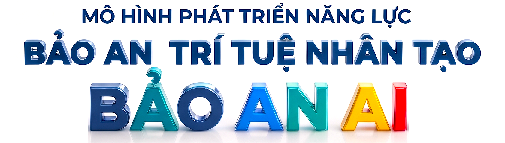
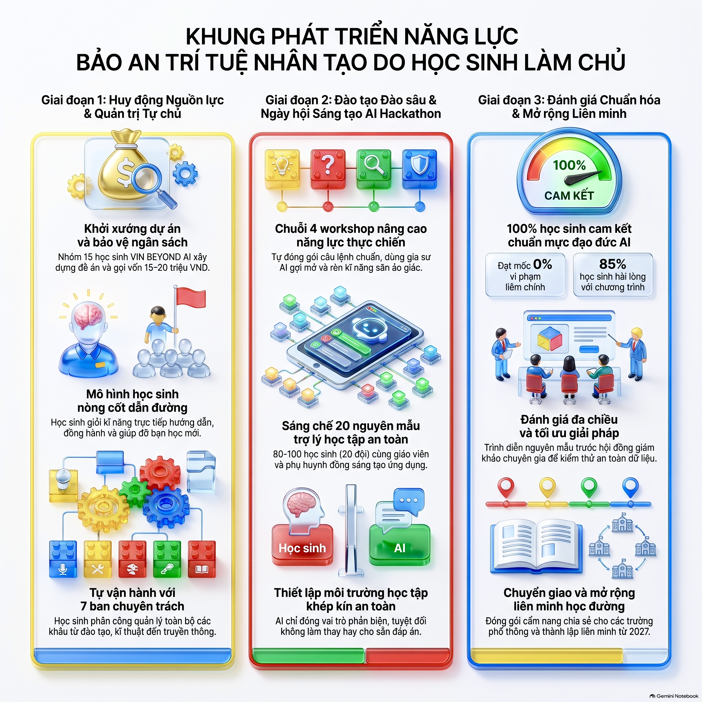
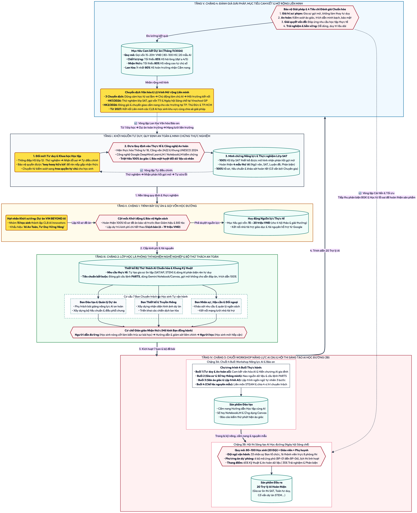
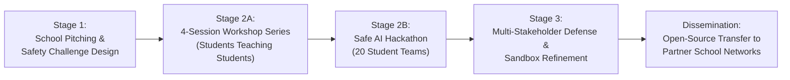
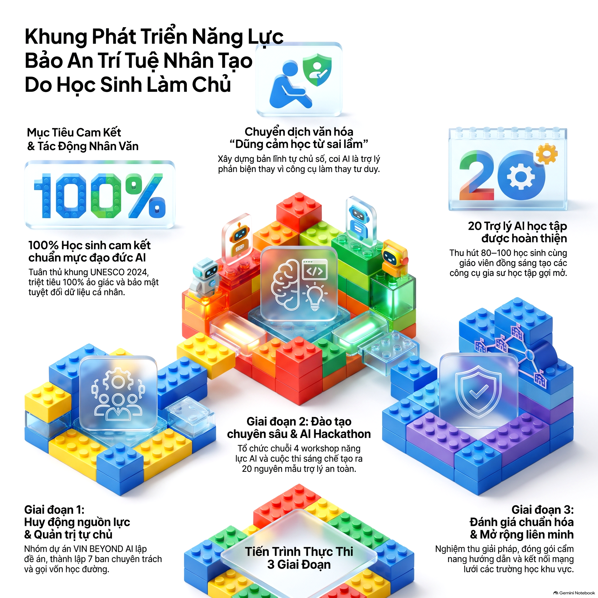

# AI SAFETY COMPETENCY FRAMEWORK
### Open Educational Resources (OER) for K-12 AI Capacity Building & Safe Learning Appathons
**A Universal Framework for Secondary Schools, Learning Communities & Educational Organizations**  
*Incubated by the VIN BEYOND AI Student Pioneer Club — Motto: "Safe AI, Stronger Minds"*

[](LICENSE)
[](https://unesco.org)
[](https://moet.gov.vn)
[](#)
[](#)
[](#)
[-purple.svg)](#)

---

🌐 **Languages / Ngôn ngữ:** [Tiếng Việt (Bản chuẩn)](README.md) | **English (Global Edition)**

> 🔒 **Copyright & Trademark Notice:** © 2026 Pham Ba Hong Son (Mike Pham). Copyright on the work "AI Safety Competency Framework (Mô hình phát triển năng lực bảo an trí tuệ nhân tạo)" and the Trademark "BẢO AN AI"™ are protected under the Intellectual Property Law of Vietnam and international conventions.

---

## 📌 1. ARCHITECTURAL OVERVIEW: ROOT FRAMEWORK & STUDENT-LED IMPLEMENTATION

In the era of Generative AI, K-12 students face a pervasive cognitive risk: **passive AI reliance and cognitive offloading**, where learners use conversational AI as an automated homework-completing engine rather than an intellectual sparring partner. This bypasses genuine critical thinking, diminishes metacognition, and threatens academic integrity.

Both the **UNESCO AI Competency Framework for Students (2024)** and the **Ministry of Education and Training of Vietnam (Circular 18/2026/TT-BGDĐT & Official Dispatch 2422/BGDĐT-CNTT)** mandate that schools establish rigorous ethical norms and empower learners to safely govern emerging technologies.

To address this, the project is architected into two interconnected tiers:

### 🏛️ 1.1. Root Competency Framework (Theoretical & Technical Foundation)
* **Official Title:** **AI SAFETY COMPETENCY FRAMEWORK** *(Mô hình phát triển năng lực bảo an trí tuệ nhân tạo)*.
* **Role & Significance:** Serves as the **master foundational competency architecture** authored by Pham Ba Hong Son (Mike Pham) originating from a Scopus Q1-indexed international research paper (presented at the IEEE iSTEM-Ed 2026 International Conference). It defines universal standards for cognitive protection, UNESCO 2024 ethical norms, strict student privacy protection (Zero-PII Safe Sandbox), and Socratic inquiry-based scaffolding.
* **Legal Status:** This constitutes the primary foundational intellectual creation protected under Author's Copyright and the registered proprietary trademark **"BẢO AN AI"™** under the Intellectual Property Law of Vietnam and the Berne Convention.

### 🚀 1.2. Student-Led School Implementation Model (Inherited Framework)
* **Implementation Title:** **Student-Led AI Safety Competency Framework** *(Mô hình phát triển năng lực bảo an AI do học sinh làm chủ)*.
* **Inheritance & Operationalization:** This model is **directly inherited and operationalized from the Root Competency Framework**. Rather than imposing top-down restrictions, it translates abstract ethical principles into authentic student action through full learner agency:
  * Incubated and piloted within the pioneering student tech club (VIN BEYOND AI).
  * Empowers core student leaders to author formal micro-grant proposals, design real-world problem sets, and lead 4-session peer-to-peer training workshops for fellow students.
  * Autonomously orchestrates school-wide Safe AI Appathons (Hackathons), creating verified Socratic learning assistants customized to real student needs.
* **Open Educational Transfer:** Structured as modular Open Educational Resources (OER), universally adaptable for any secondary school or educational community globally.



```
[Passive AI Reliance / Cognitive Offloading] 
       ⬇ (Pedagogical Shift: Embrace Productive Struggle & Trial-and-Error)
[Student Core Team Drafts Proposals & Secures 15–20M VND Micro-Grant]
       ⬇ (Peer-to-Peer Pedagogy: 4-Session Student-Led Workshops)
[Safe AI Hackathon: 20 Teams Build Verified Socratic Learning Assistants]
       ⬇ (AI Scaffolds Step-by-Step, Mandates Citations, Refuses Shortcuts)
[Empowered Students & Scalable Inter-School OER Transfer]
```

---

## 💡 2. COGNITIVE INNOVATION: "EMBRACING PRODUCTIVE STRUGGLE"

The foundational ethos of this framework originates directly from a 12th-grade student leader:  
> *"Instead of fearing errors or using AI for instant shortcuts to bypass intellectual struggle, students must boldly experiment, confront misconceptions through trial and error, and iterate deliberately to achieve authentic mastery."*

* **Cognitive Science & "Productive Struggle":** Based on Susanne Narciss's multi-tiered formative feedback model, human memory and deep understanding develop only when the brain actively grapples with cognitive friction. Instant answers eliminate productive struggle and erode genuine learning.
* **Socratic Guardrails:** In every AI application developed within this framework, system prompts strictly forbid direct answers. The AI acts as a patient Socratic mentor, providing scaffolded hints, probing counter-questions, and contextual clues while firmly declining requests to complete the task on behalf of the student.

---

## 🏗️ 3. SYSTEM ARCHITECTURE & 8 CORE ACTION MILESTONES

The entire model has been formalized into an actionable, closed-loop implementation architecture replicable in any secondary school globally:



### The 8 Core Action Milestones:
1. **Student-Led Pitching & Micro-Grants:** The student leadership team crafts formal proposals and pitches before the School Board to secure 15–20M VND in seed operational funding.
2. **Peer-to-Peer Pedagogy:** Tech-empowered students design curriculum and directly facilitate interactive training sessions for fellow peers across all grades.
3. **Cross-Functional Role Specialization:** Student teams self-organize into specialized pods: Prompt Engineering, Pedagogical Review, UI/UX Design, Public Relations, and Technical Logistics.
4. **Safety & Integrity Culture:** School-wide institutionalization of Zero-PII (Personally Identifiable Information) compliance and ethical AI pledges aligned with UNESCO standards.
5. **Multi-Stakeholder Co-Creation:** Engaging 80–100 students (20 hackathon teams), alongside teachers and parent observers, in collaborative tool creation.
6. **Strict Socratic Prompt Engineering:** Enforcing prompt guardrails (PARTS Framework) and grounding AI models in verified textbooks to eradicate hallucinations.
7. **Safe Prototype Defense & Sandbox Testing:** Student teams defend their functional prototypes before an interdisciplinary judging panel, testing against prompt injection and data privacy breaches.
8. **Open Educational Packaging (OER):** All implementation playbooks, rubric rubrics, and source prompts are released under the MIT License for open inter-school dissemination from 2027 onward.

---

## 🚀 4. THE 4-STAGE IMPLEMENTATION ROADMAP



### 🔹 Stage 1: School Pitching & Challenge Design (Month 1 / Weeks 1–4)
* **Proposal & Pitching:** Student core team designs 5 tiered budget scenarios (6M to 19.5M VND) and delivers a formal pitch to school administrators to secure operational approval ([View Budget Pitching Template](templates/Budget_Pitching_PR_Template_EN.md)).
* **Authentic Needs Assessment:** Administering school-wide surveys to identify high-friction academic challenges (SAT verbal reasoning, advanced mathematics, STEM inquiry).
* **Challenge Standardization:** Establishing problem sets grounded in the core rule: **AI must provide 100% textbook-anchored citations and strictly refuse to solve exercises outright**.

### 🔹 Stage 2A: 4-Session Student-Led Workshop Series (Month 1–2 / Weeks 5–8)
* **Session 1: Foundational Mindset & Digital Safety:** Unpacking AI opportunities versus cognitive dependency; signing the Zero-PII & UNESCO-aligned ethical AI charter.
* **Session 2: Socratic AI & Smart Study Notebooks:** Hands-on training with Gemini Notebooks anchored directly to verified curriculum materials; mastering the PARTS prompt engineering framework.
* **Session 3: Hallucination Hunting & Natural Language App Building:** Training students to detect generative hallucinations; introducing no-code "Vibe Coding" via Gemini Canvas to build interactive study tools.
* **Session 4: Prototype Polishing & Hackathon Sprint Prep:** Organizing 20 teams into 4 structured roles (Prompt Engineer, Content Validator, UI/UX Designer, Lead Pitcher) and completing MVP prototypes.

### 🔹 Stage 2B: School-Wide Safe AI Hackathon (Month 2 / Weeks 9–10)
* **Scale:** 80–100 student competitors (20 interdisciplinary teams), attended by teachers and parents.
* **Student Operations:** 33 student committee members coordinate testing rooms with 6 pre-engineered contingency protocols (BP-01 to BP-06).
* **Deliverables:** 20 verified, safe AI study assistants deployed (SAT Reading & Writing Coach, Socratic Math Mentor, STEAM Inquiry Advisor, Literature Analysis Companion).

### 🔹 Stage 3: Multi-Stakeholder Evaluation & Sandbox Testing (Month 2 / Weeks 11–12)
* **Live Sandbox Defense:** 20 finalist teams demonstrate their applications live before a panel of educators, tech professionals, and parent representatives.
* **Standardized 100-Point Rubric:** 65% allocated to Socratic pedagogical fidelity and Zero-PII privacy safety; 35% allocated to usability and curriculum alignment ([View Scoring Rubric](docs/05_AI_Appathon_Scorecard_Rubric_EN.md)).
* **Iterative Refinement:** Integrating feedback to harden guardrails prior to school-wide classroom deployment.

---

## 🛠️ 5. SAFE AI SANDBOX ARCHITECTURE & SOCRATIC PARTS PROMPTING

To eliminate data harvesting and generative hallucinations, the framework enforces a **Controlled Sandbox Architecture**:

```
[Curated Curricular Textbooks / Peer-Reviewed Sources]
                        ⬇
    [Isolated Sandbox Workspace: Gemini Notebook]
                        ⬇
    [PARTS Socratic Prompt Architecture (Google Standard)]
                        ⬇
    [Student Interaction: Scaffolded Hints • Metacognitive Agency]
```

👉 **Access and clone the production-ready prompt formulas:** [`templates/Socratic_Prompt_PARTS_Templates_EN.md`](templates/Socratic_Prompt_PARTS_Templates_EN.md)

---

## 📊 6. EMPIRICAL RESULTS & COMMITTED TARGETS

The framework has been tested and implemented in practice within the core student pioneer club (VIN BEYOND AI) with demonstrated pedagogical impact:
* **4 Production-Grade Safe Prototypes Tested & Verified:**
  1. *SAT Verbal & Analytical Coach:* Guides students through reading passage structure, word-in-context elimination, and logic analysis.
  2. *Socratic Math Mentor:* Scaffolds algebraic transformations step-by-step; steadfastly declines answer requests.
  3. *STEAM Inquiry & Research Advisor:* Directs hypothesis formulation, research methodologies, and citation credibility.
  4. *Pocket Digital Safety Guide:* Educates peers on detecting algorithmic bias, deepfakes, and privacy vulnerabilities.
* **100% Initial Core Project Members Signed Ethical Pledge:** Complete alignment with UNESCO 2024 AI competencies and national education policies.
* **International Academic Publication:** Scopus Q1-indexed empirical study presented at the **IEEE iSTEM-Ed 2026 International Conference**, providing empirical evidence on the cognitive efficacy of Socratic AI feedback in secondary education.
* **Future Universal Scaling Targets:** Expanding the club-incubated model into campus-wide and inter-school networks, targeting 80–100 participants (20 teams) per cycle, >85% user satisfaction rate, and >80% increase in student digital agency and self-efficacy.



---

## 📂 7. REPOSITORY RECOURSE DIRECTORY (OPEN EDUCATIONAL RESOURCES)

All resources are openly accessible for schools and educators worldwide:

```text
bao-an-ai/
├── README.md                                  # Complete Framework Overview (Vietnamese Edition)
├── README_EN.md                               # Global Framework Overview & Specifications (English Edition)
├── LICENSE                                    # Open-Source MIT License (100% Free Adoption)
├── assets/                                    # High-Resolution Schematics & Diagrams
│   ├── banner.png                            # Official Bảo An AI Hero Banner
│   ├── He_Thong_Hoa_Mo_Hinh.png              # Complete High-Res System Flowchart (2048x2048)
│   ├── Poster.png                            # High-Resolution Academic Poster Presentation
│   ├── framework_diagram.jpg                 # 4-Stage Implementation Overview
│   ├── framework_diagram.png                 # Process Flow Infographic
│   └── framework_architecture.png            # Safe Technology Architecture
├── docs/                                      # Operational Guides, Policies & Rubrics
│   ├── Bai_Trinh_Chieu_15_Slides.pdf          # Official 15-Slide Presentation Deck (RMIT Standard)
│   ├── Poster_Gioi_Thieu_San_Pham.pdf         # Official Academic Poster Presentation
│   ├── Cam_Nang_Huong_Dan_Trien_Khai_Va_Dao_Tao_Nhan_Rong_Mo_Hinh.docx # Complete K-12 Playbook (VI)
│   ├── Ho_So_Minh_Chung_Nang_Luc_Cua_Nhom_Du_An_Vin_Beyond_AI.docx      # Project Portfolio & Evidence (VI)
│   ├── 01_Huong_Dan_Trien_Khai_Hoc_Duong.md   # Step-by-Step K-12 School Guide (Vietnamese)
│   ├── 01_K12_Implementation_Guide_EN.md     # 4-Stage K-12 Implementation Roadmap (English)
│   ├── 02_Khung_Cam_Ket_AI_Norms_UNESCO.md    # Ethical AI & Data Privacy Charter (Vietnamese)
│   ├── 02_UNESCO_AI_Norms_Charter_EN.md       # Ethical AI & Data Privacy Student Charter (English)
│   ├── 05_AI_Hackathon_Scorecard_Rubric.md    # 100-Point Hackathon Evaluation Rubric (Vietnamese)
│   └── 05_AI_Appathon_Scorecard_Rubric_EN.md  # 100-Point Evaluation Rubric (English)
└── templates/                                 # Ready-to-Use Templates & Prompt Libraries
    ├── Budget_Pitching_PR_Template.md         # Tiered Pitching & Budgeting Template (Vietnamese)
    ├── Budget_Pitching_PR_Template_EN.md      # School Pitching & Tiered Budget Template (English)
    ├── Socratic_Prompt_PARTS_Templates.md     # Socratic Prompt Engineering Templates (Vietnamese)
    └── Socratic_Prompt_PARTS_Templates_EN.md  # Socratic PARTS Prompt Engineering Templates (English)
```

---

## 📜 8. COPYRIGHT, TRADEMARK & OPEN-SOURCE MIT LICENSE

> **© 2026 Pham Ba Hong Son (Mike Pham). Copyright on the work "AI Safety Competency Framework (Mô hình phát triển năng lực bảo an trí tuệ nhân tạo)" is protected under the Intellectual Property Law of Vietnam and the Berne Convention.**
>
> **™ "BẢO AN AI" and the official tagline "Bảo an AI, sáng tạo hân hoan" are proprietary trademarks and intellectual property of Pham Ba Hong Son, protected under industrial property regulations.**

This framework and all associated Open Educational Resources (OER) are published under the **[MIT License](LICENSE)**:
* ✅ Free for all secondary schools, educational organizations, educators, researchers, and students to download, adapt, translate, and deploy.
* ⚠️ **Trademark Notice:** The MIT License grants rights to the code and educational materials, but explicitly **does NOT** grant any right or license to use the trademark **"BẢO AN AI"™** or commercialize the brand identity without prior written permission from the author.
* ✅ Zero licensing fees, dedicated to advancing equitable, safe, and human-centered AI education globally.

---

## 👨‍🏫 9. AUTHOR & ACADEMIC MENTOR

* **Pham Ba Hong Son (Mike Pham)**
* **Credentials & Academic Affiliations:**
  * Official Google for Education Certified Innovator: [edudirectory.withgoogle.com/profiles/5087615831769088](https://edudirectory.withgoogle.com/profiles/5087615831769088) (*#MEL26, Melbourne Australia*)
  * Postgraduate Researcher, Institute of Technical Education, Ho Chi Minh City University of Technology and Education (HCMUTE)
  * Author of Scopus Q1-indexed research paper presented at the **IEEE iSTEM-Ed 2026** International Conference
* **Professional Domain:** SAT Educator, EdTech Innovation & Educational Researcher, Ho Chi Minh City, Vietnam.
* **Email:** mikepham358@gmail.com
* **GitHub Repository:** [github.com/mikepham358/bao-an-ai](https://github.com/mikepham358/bao-an-ai)

---

> *"Bảo An AI, Sáng Tạo Hân Hoan"*
